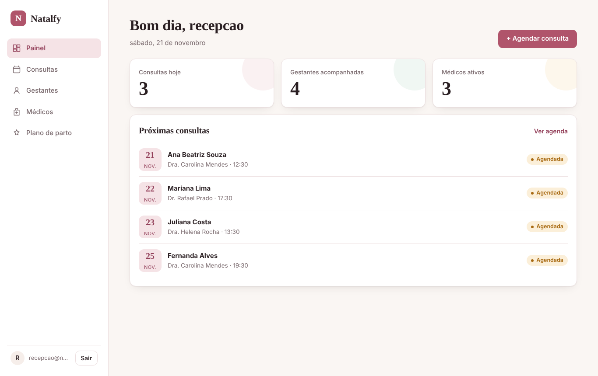
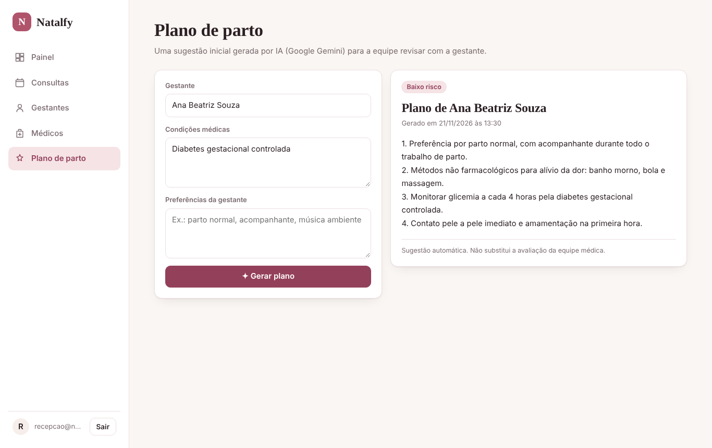

# Natalfy · Frontend

Interface web da **Natalfy**, sistema de gestão de clínica obstétrica. Consome a [natalfy-api](https://github.com/Ericklevy/natalfy-api) (Java 21 + Spring Boot) e cobre o dia a dia da recepção: gestantes, médicos, agenda de consultas e um plano de parto sugerido por IA.


| Painel | Celular |
|---|---|
|  |  |

## Funcionalidades

- **Login e cadastro de acesso** com JWT. O token fica salvo no navegador e vai em todas as chamadas por um interceptor.
- **Painel** com consultas do dia, gestantes acompanhadas, médicos ativos e as próximas consultas.
- **Consultas:** filtro por status, paginação, agendamento, cancelamento com motivo e finalização com prontuário. As regras da API (horário de funcionamento, 30 min de antecedência para agendar, 24 h para cancelar) aparecem como mensagens claras.
- **Gestantes:** busca por nome ou e-mail, cadastro com máscara de CPF e inativação (só para perfil ADMIN, regra da API).
- **Médicos:** cartões da equipe e cadastro com sugestões de especialidade.
- **Plano de parto com IA:** envia condições e preferências para o endpoint do Google Gemini da API e mostra o plano gerado.

## Responsivo de verdade

No desktop, navegação lateral. No celular, barra de abas embaixo, tabelas que viram cartões e formulários que abrem como painel de baixo para cima, respeitando a área segura do iPhone.

| Agendar no celular | Plano de parto |
|---|---|
|  |  |

## Decisões técnicas

- **Angular 19 standalone**, com signals para o estado de cada tela e a nova sintaxe de controle de fluxo (`@if`, `@for`).
- **Rotas com lazy loading:** cada tela é um pedaço separado do bundle (cerca de 2 a 3 kB cada, comprimido).
- **Tipos espelhando os DTOs da API** em `src/app/core/models.ts`, para o compilador avisar se o contrato mudar.
- **Erros da API traduzidos** em `mensagemDeErro`: listas de validação, textos simples, API fora do ar e falta de permissão viram mensagens em português.
- **Sem CORS:** em desenvolvimento o `ng serve` faz proxy de `/api` para a porta 8081; no Docker o nginx faz o mesmo papel.
- **Sem bibliotecas de UI:** estilos próprios em SCSS, ícones em SVG inline.

## Como rodar

Primeiro suba a API pelo repositório [natalfy-api](https://github.com/Ericklevy/natalfy-api) (`docker compose up`). Ela fica na porta **8081**.

**Com Docker:**

```bash
docker compose up --build
```

Acesse http://localhost:4200.

**Em modo de desenvolvimento:**

```bash
npm install
npm start
```

Na tela de login, use **"Ainda não tem acesso? Criar"** para cadastrar um usuário e depois entre com ele.

## Testes

```bash
npx ng test --watch=false --browsers=ChromeHeadlessCI
```

Os testes cobrem a tradução de erros da API, a máscara de CPF e a listagem com busca de gestantes. O GitHub Actions roda os testes e o build a cada push.

## Estrutura

```
src/app
├── core/        modelos, serviço da API, autenticação (guard + interceptor)
├── layout/      casca com navegação lateral e abas no celular
└── pages/       login, painel, consultas, gestantes, médicos, plano de parto
```
